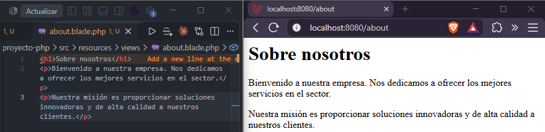
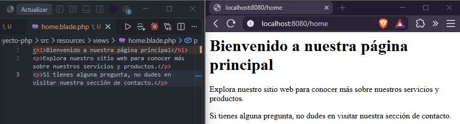
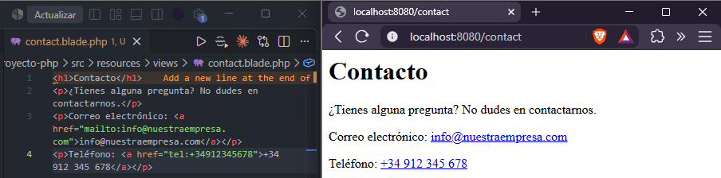

# Tema 01: Instalación con Docker

| | |
|---|---|
| **Fecha de inicio** | 09/11/2026 |
| **Fecha de fin** | 16/11/2026 |
| **Tiempo dedicado** | 1 horas |
| **Rama de Git** | `tema01` |

---

## 1. 🎯 Objetivo del tema

Instalación del proyecto con Docker y creación del proyecto Laravel.
---

## 2. 🛠️ Desarrollo paso a paso

<!-- Un apartado por cada paso importante. Para cada uno:
     - Qué haces y POR QUÉ.
     - El comando o el código, en un bloque de código (nunca como captura).
     - Una captura solo si aporta algo visual (navegador, resultado, estructura...). -->

### 2.1 Creación de vistas

Se van a crear tres vistas llamadas: home, about y contact.

vista *about.blade.php*


vista *home.blade.php*


vista *contact.blade.php*

### 2.2 [Nombre del paso]

```php
 Route::view('/', 'home')->name('home');
 Route::view('/about', 'about')->name('about');
 Route::view('/contact', 'contact')->name('contact');
```
---

## 3. 📋 Resumen de comandos utilizados

| Comando | Para qué sirve |
|---------|----------------|
| `composer ...` | ... |
| `docker-compose` | ... |

---

## 4. 🐞 Problemas encontrados y soluciones

<!-- Documenta TODOS los problemas, aunque te parezcan tontos.
     Copia el error como texto, no como captura.
     Si no has tenido ningún problema, documenta al menos algo que hayas tenido que investigar. -->

### Problema 1: Comprobación del funcionamiento de Laravel después de su instalacón

**Qué estaba haciendo:** Comprobar el correcto funcionamiento de Laravel una vez crado el proyecto básico.

**Error:**

```
Problema de permisos.
```

**Causa:** Posible problema de permiso

**Solución:**

Ejecutamos en una terminal los siguientes comandos

```bash
docker exec -it proyecto-php-1 bash
php artisan key:generate
chmod -R 775 storage bootstrap/cache
chown -R www-data:www-data storage bootstrap/cache
```

Posteriormente será necesario añadir en el fichero .env

```bash
DB_HOST=mysql
DB_PORT=3306
DB_DATABASE=test
DB_USERNAME=alumno
DB_PASSWORD=alumno

SESSION_DRIVER=file
```


**Fuente:** ChatGPT.


---

## 5. ✅ Resultado final

<!-- Captura(s) de la aplicación funcionando al terminar el tema. -->

vista *about.blade.php*


vista *home.blade.php*


vista *contact.blade.php*


---

## 6. 💭 Conclusiones

- **Qué he aprendido:** ...
- **Qué me ha costado más:** ...
- **Qué haría diferente / dudas pendientes:** ...
